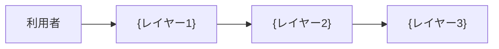

# アーキテクチャ設計書 (Architecture Design Document)

## 技術スタック

| 分類 | 技術 | バージョン | 用途 | 選定理由 |
|------|------|-----------|------|---------|
| 言語 | {言語} | {バージョン} | | {理由} |
| 依存の管理 | {ツール} | {バージョン} | 依存の管理とコマンドの実行 | {理由} |
| {分類（例: データの検証、設定、DI、永続化、HTTP API）} | {ライブラリ} | {バージョン} | {用途} | {理由} |

### 開発ツール

| 分類 | ツール | 用途 |
|------|-------|------|
| テスト | {ツール} | テストとカバレッジ |
| リント | {ツール} | |
| 型チェック（該当する場合） | {ツール} | |
| 依存ルールのチェック | {ツール} | モジュール境界と外部依存のチェック |

## アーキテクチャ

### 全体像

### レイヤー構成

採用する構成: {例: 入口 / サービス / データアクセス、ポートとアダプター}

選んだ理由: {理由}

| レイヤー | 置き場所 | 責務 | 依存してよいレイヤー |
|---------|---------|------|-------------------|
| {レイヤー1} | `{置き場所}` | {責務} | {レイヤー} |
| {レイヤー2} | `{置き場所}` | {責務} | {レイヤー} |
| {レイヤー3} | `{置き場所}` | {責務} | なし |

### モジュール依存表

依存ルールのチェックツールの設定と同じ内容にする。

| モジュール | 依存してよいモジュール |
|-----------|---------------------|
| `{モジュール}` | {なし、または依存先} |
| `{設定のモジュール}` | なし |
| `{ログのモジュール}` | `{設定のモジュール}` |
| `{入口のモジュール}` | {依存先} |

### 実装の差し替え（該当する場合）

| 名前 | 抽象 | 実装 |
|------|------|------|
| `{名前}` | `{抽象}` | `{実装}` |

## 設定

| 環境変数 | 既定値 | 内容 |
|---------|-------|------|
| `{環境変数名}` | {既定値} | データとログの置き場所の基準 |
| `{環境変数名}` | {既定値} | ログのファイル |
| `{環境変数名}` | {既定値} | {特定の技術の設定（例: SQLite のファイルの場所）} |
| `{環境変数名}` | {既定値} | {入口の設定（例: HTTP API が待ち受けるホストとポート）} |

## 永続化（該当する場合）

### ストレージ

| データ | ストレージ | 理由 |
|-------|----------|------|
| {データ} | {例: SQLite} | {理由} |

### スキーマの管理

- 作り方: {例: 起動時にまとめて作る、マイグレーションツールを使う}
- 理由: {理由}

### バックアップ（該当する場合）

- {方法と頻度}

## 非機能要件

### 性能

| 操作 | 目標 | 測定条件 |
|------|------|---------|
| {操作} | {時間} | {データ量、環境} |

### セキュリティ

- {受け付けるホスト、認証の有無、機密情報の扱い}

## テスト戦略

| 対象 | 置き場所 | 方法 |
|------|---------|------|
| 公開 API（関数、メソッド、エンドポイント、コマンドなど） | `{テストファイルのパス}` | {例: 本物の依存先を使う、HTTP API はテスト用のクライアントで呼ぶ} |

- カバレッジの下限: {70}%
- テスト用の偽物に差し替えるもの: {なし、または外部プロセスなど}

## 品質ゲート

| チェック | コマンド |
|---------|---------|
| テスト（カバレッジの下限を含む） | `{コマンド}` |
| リント | `{コマンド}` |
| 型（該当する場合） | `{コマンド}` |
| 依存ルール | `{コマンド}` |

## 技術的制約

- 対応 OS: {OS}
- 言語のバージョン: {範囲}（{理由}）
- {そのほかの制約}
