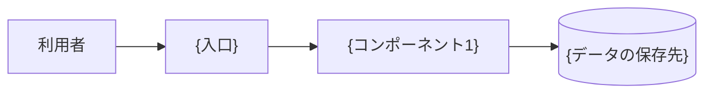
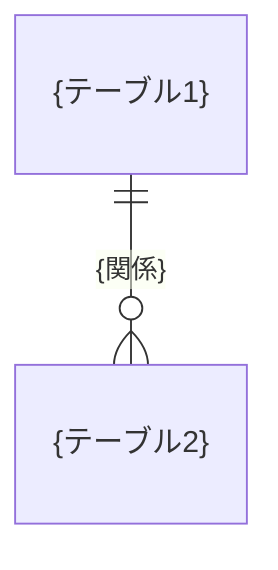
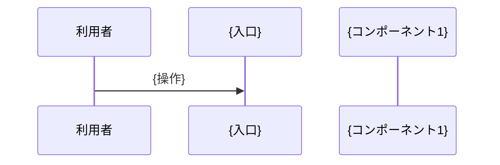

# 機能設計書 (Functional Design Document)

## システム構成図

{構成の説明}

## データモデル

### {データ名}

| 属性 | 型 | 制約 | 説明 |
|------|----|------|------|
| `{属性}` | {型} | {制約} | {説明} |

**ルール**:
- {例: 同じ名前のものは作れない}

### テーブル（DB を使う場合）

#### {テーブル名}

| カラム | 型 | 制約 | 説明 |
|-------|----|------|------|
| `{カラム}` | {型} | {PK、NOT NULL、UNIQUE、FK → `{テーブル}.{カラム}`（ON DELETE {RESTRICT / CASCADE}）など} | {説明} |

#### ER図

正規化を崩した箇所: {なし、または箇所と理由}

## コンポーネント設計

### {コンポーネント1}

**責務**:
- {責務}

**公開 API**:

| 関数 / メソッド | 引数 | 戻り値 | 送出する例外 | PRD の機能 |
|---------------|------|-------|-------------|-----------|
| `{公開 API 名}` | {引数と型} | {型} | `{例外クラス名}` | {機能名} |

**依存先**:
- {依存先}

## ユースケース（込み入ったものだけ記述する）

### {ユースケース名}

## HTTP API（該当する場合）

| メソッド | パス | 呼び出す関数 | 成功 | エラー |
|---------|------|------------|------|-------|
| {メソッド} | `/api/{リソース}` | `{関数}` | {ステータス} | {ステータス} |

### {メソッド} /api/{リソース}

- リクエスト: {ボディの形}
- レスポンス（{ステータス}）: {ボディの形}

## CLI（該当する場合）

| コマンド | 呼び出す関数 | 出力 |
|---------|------------|------|
| `{コマンド} {引数}` | `{関数}` | {出力} |

## エラーハンドリング

| エラーの種類 | 例外クラス | 継承元 | {入口}での扱い | 利用者へのメッセージ |
|------------|-----------|--------|--------------|-------------------|
| 見つからない | `{例外クラス名}` | {継承元（例: Python なら `LookupError`）} | {例: HTTP 404、終了コード 1} | {メッセージ} |
| 既にある | `{例外クラス名}` | {継承元} | {扱い} | {メッセージ} |
| 入力が不正 | {検証の例外} | {継承元} | {扱い} | {検証のメッセージ} |
| 外部の処理の失敗 | `{例外クラス名}` | {継承元} | {扱い} | {メッセージ} |

## 初期データ（該当する場合）

{初回の起動で作るデータとその内容}
